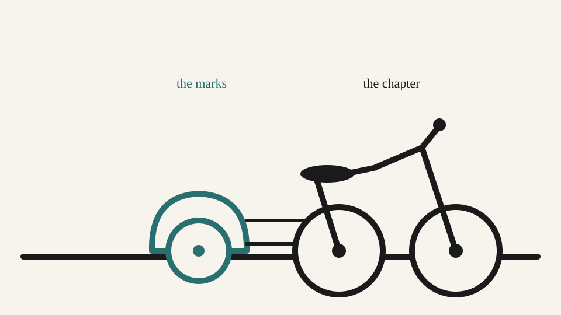

# The Sidecar

Notes that live inside the draft move when the draft moves, and they don't tell you they moved: that's the fifteen minutes.

Mark keeps his notes inside the prose itself, in brackets, in a color Quarto strips before anyone else reads it.
One reads `[TODO: does she know about the letter yet?]`, sitting two lines under the paragraph it's about.
That works until the day it doesn't.

Hal reflows a paragraph for pacing, the way Mark asked, and the note rides along with whatever text happens to be nearest when the dust settles.
It lands under a paragraph about a different letter, three sections down, looking exactly as confident as it did in its old home.
Mark doesn't notice for a week.
When he does, the note has quietly told him a character knows a secret she hasn't been told yet, and he's already written two scenes on the strength of it.

He brings this to Sid, who fixes motorcycles on weekends and edits nothing.
Sid's answer: your notes ride in the story, of course they fall off when you hit a bump, put them in a sidecar.
A sidecar carries a passenger without changing how the bike leans.
You can take it off entirely and the bike still runs, it just runs alone.

Mark makes that literal.
One file of notes per chapter, living beside it, never inside it, with headings that mirror the chapter's own so a note still knows which paragraph it's talking about even after that paragraph moves.
Hal can reflow all he likes;
the note doesn't move, because it was never standing on the paragraph in the first place.

{#fig-sidecar fig-alt="A line drawing of a motorcycle in profile with a sidecar attached to it by two struts. The motorcycle is labeled the chapter; the sidecar is labeled the marks."}

The second thing this buys: when nobody can remember who wrote the sentence in chapter four that everyone keeps quoting back to Mark at parties, the logs know.
Prue Vennance, the archivist who put this book together, is the one who actually asks.
Mark's draft, timestamped, then Hal's revision four minutes later, is the sentence people actually quote, and the log is the only one of the three of them sure of it.

And the name: the sticky note on Mark's monitor has said "quirk work" for a while now, for the file of commitments he refuses to call commitments.
He types it into a terminal one evening and his editor corrects it to "quirework," a word he's fairly sure he's never typed before.
He looks it up, looks at the folder on his disk, which isn't a book yet by any definition he'd defend under questioning, and ships the whole thing under that name anyway.
